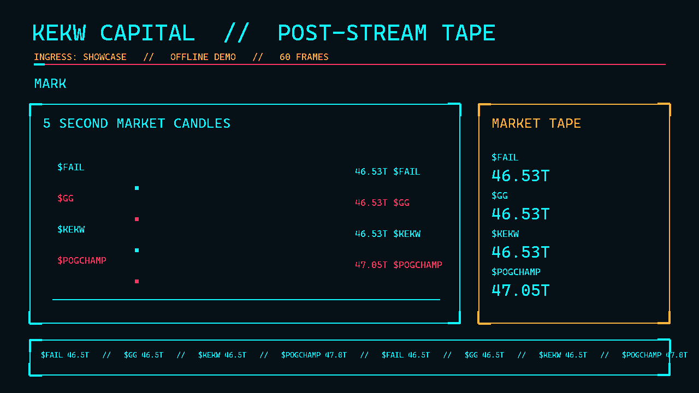

# KEKW CAPITAL

**The AI-hosted emote stock exchange for Twitch chat.** Every spammed emote can become a ticker; deterministic market rules price chat momentum, and Oddity turns the tape into a live financial-news spectacle. Chat gets Tendies, headline cameos, PRIME TIME duels, and shareable MARKET CLOSE cards.



## “The market is honest”

The LLM narrates; it never sets prices. Fast and slow EMAs measure token volume in rolling five-second windows:

```text
mom = EMA(tokens/5s, α=0.3) / EMA(tokens/5s, α=0.01)
price_delta = clamp(k1*log(mom) + k2*buy_sell_skew + shock_bias, ±0.25)
```

Orders batch at 1Hz; candles are 5s OHLC. The synthetic maker fills buys at ask (price × 1.01) and sells at bid (price × 0.99). Blue chips and new listings start at 50T. Tendies are game coins: 100T on first chat, 1T/min live (20T/stream cap), 10T first trade, and founder bonus 10T for the first three traders of each listing.

## Quickstart

Requires Python 3.10+. Install `pip install -e ".[test]"`. Copy `.env.example` to `.env`. Chat replies for `!balance`, `!portfolio`, and `!found` are sent in chat.

For LIVE: create a separate Twitch bot account; create an application in Twitch Developer Console; use a long-lived user token with `chat:read chat:edit channel:moderate user:read:chat`; paste the token, bot login name, and client ID in `.env`. Add the bot account as a channel moderator. The app never runs an OAuth callback server.

```powershell
python -m kekw --channel YOUR_CHANNEL --source irc --web
```

For network-free SHOWCASE:

```powershell
python -m kekw.mock.showcase
```

The demo timeline and JSONL are checked in at `kekw/mock/demos/`. It creates a temporary SQLite DB. `python -m kekw --channel demo --source file --path kekw/mock/demos/stage_messages.jsonl` also replays the messages through the live market spine.

## OBS setup

Run with `--web`; add a Browser Source pointing to `http://127.0.0.1:8000/` (1920×1080 recommended). Keep `/dash` open on the operator display. The overlay uses JSON WebSocket events and vanilla Canvas/HTML; no browser extension is needed. The dashboard recap button or chat `!recap` writes PNGs and HTML under `recaps/`, including the best-trader-of-the-day card and verdict-call streak badge. RED-KEY records 15fps PNG frames under `recordings/red-key/` (install optional recorder extras with `pip install -e '.[recorder]'`).

After stream, `POST http://127.0.0.1:8000/control/tape` renders `recaps/tape.mp4` from the recap PNGs with a `tts-1` desk read. This optional export needs `OPENAI_API_KEY` and `ffmpeg` available on PATH (or `FFMPEG_BINARY`); the normal PNG and HTML recaps remain available when either is missing. `KEKW_GENERATE_VOICES=1` is the separate offline batch for the six event cues and five Oddity idle wav lines.

## Twitch and non-affiliate fact sheet

- No affiliate status is needed. KEKW CAPITAL does not use Channel Points, predictions, polls, or clips.
- IRC is the chat ingress; EventSub and full OAuth are not part of this build.
- Keep the bot token private. Revoke and replace it if it appears in a recording.
- A bot account and moderator permission are needed for a live channel.

## Economy, ethics, and privacy

Tendies are fictional game coins. They cannot be purchased, redeemed, tipped, or paid out. PRIME TIME is an in-game event contract, not a real-money wager or an affiliate predictions feature. Any streamer prizes are manually awarded and are outside this software.

Chat messages, Twitch user IDs, wallets, and ledgers are processed/stored locally in SQLite. No DMs are sent. The headline prompt may include the last 40 public chat lines and display names from recent trades; keep this visible and avoid sensitive content. OpenAI receives market context and recent public lines when headlines are enabled. If the operator runs `/control/tape`, the post-stream `tts-1` read also sends its recap narration text, including the daily leader's display name and Tendies result, to OpenAI.

## Prior art and distinction

Projects such as twitch-trader, Stocks-of-Razbia, and TwitchStocks demonstrate chat-driven virtual markets. KEKW CAPITAL builds on that category with a deterministic, legible pricing formula, a single AI headline desk, named trade cameos, Oddity’s live host arc, PRIME TIME, and recap artifacts designed for the stream floor. The AI narrates market data; it does not control prices.

## Built with Codex

Built in the Codex x TwitchCon Hackathon submission session, in this thread. Codex helped implement the market spine, event-driven desk, overlay, showcase, and recap workflow; the operator supplies Twitch/OpenAI credentials and runs the live demo.

## Judge Q&A

- **Cute overlay toy / pre-animated?** The wire types live model output; BREAKING can name a recent trader; `/headline-prompt` works for arbitrary emotes with a guaranteed fallback.
- **Chat economy bots already exist.** This prices chat and explains the move, hosts duel events without an affiliate gate, and gives participants recap cards.
- **Why no predictions/polls?** They are affiliate-gated. This build works for channels today.
- **Is this gambling?** No real money, purchases, cash-outs, or external outcomes. Tendies are participation game coins.
- **What does it produce?** MARKET CLOSE cards, per-user portfolio roasts, an Oddity Holdings card, and an HTML recap.
- **What if the venue network fails?** LIVE → PIT → SHOWCASE → RED-KEY, with a checked-in zero-network timeline.

The checked-in 60-frame README GIF is rendered from the same zero-network SHOWCASE timeline. The post-stream MP4 is optional and generated on demand; the showcase does not need OpenAI or ffmpeg.

Regenerate it with `python -m kekw.mock.demo_gif`.


Voice cue batch (requires OPENAI_API_KEY): `$env:KEKW_GENERATE_VOICES="1"; python -m kekw.desk.sfx` on PowerShell; `KEKW_GENERATE_VOICES=1 python -m kekw.desk.sfx` on POSIX.

The offline `tts-1` batch renders six event cues and five Oddity idle lines (`idle_1.wav`–`idle_5.wav`); idle lines are narrated only after the terminal has been quiet for a minute. No live TTS is used on stage.

