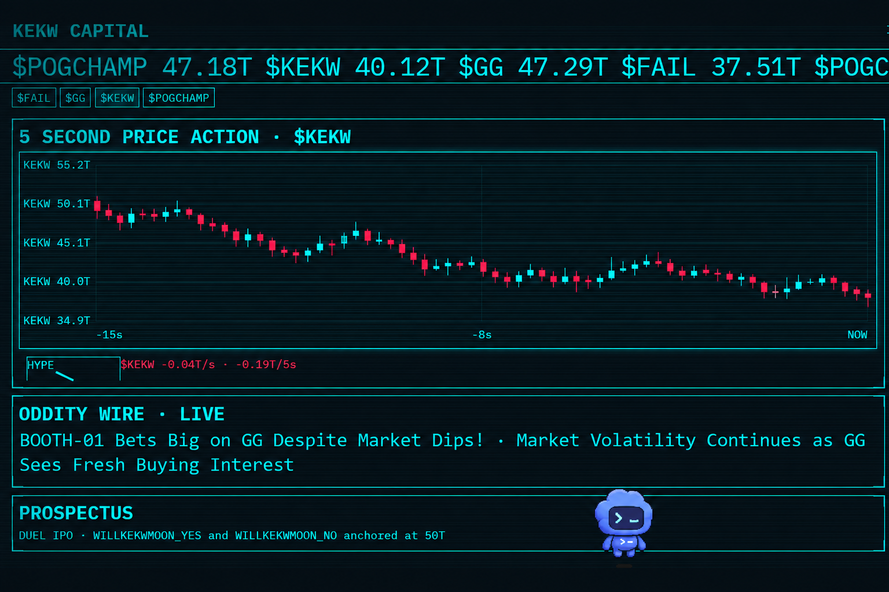

# KEKW CAPITAL

**The AI-hosted emote stock exchange for Twitch chat.** Every spammed emote can become a ticker; deterministic market rules price chat momentum, and Oddity turns the tape into a live financial-news spectacle. Chat gets Tendies, headline cameos, PRIME TIME duels, and shareable MARKET CLOSE cards.



## "The market is honest"

The LLM narrates; it never sets prices. Fast and slow EMAs measure token volume in rolling five-second windows:

```text
mom   = clamp(EMA(tokens/5s, α=0.3) / EMA(tokens/5s, α=0.01), 0.25, 8)
price_delta = clamp(k1*log(mom) + k2*buy_sell_skew, ±0.25 per move)
```

Orders batch at 1Hz; candles are 5s OHLC. The synthetic maker fills buys at the ask (price × 1.01) and sells at the bid (price × 0.99). Blue chips and new listings start at 50T. Circuit breakers halt a ticker at −20%/min and auto-resume after 60 seconds. Settled PRIME TIME tickers freeze at their settlement value (0 or 95).

**Tendies (game coins):** 100T on first chat · 1T/min while live (20T/stream cap) · 10T first-trade bonus · 10T founder bonus for the first three traders of each new listing. No purchase, no cash-out.

## Quickstart

Requires Python 3.10+. From the repo root:

```powershell
pip install -e ".[test]"
copy .env.example .env      # then fill the values below
```

### Chat commands

| Command | Example | Effect |
|---|---|---|
| `!buy` | `!buy $KEKW 10` | Buy with Tendies at the ask |
| `!sell` | `!sell $KEKW all` | Sell shares at the bid (`n` or `all`) |
| `!balance` | `!balance` | Show your Tendies |
| `!portfolio` | `!portfolio` | Show your holdings |
| `!top` | `!top` | Top-5 leaderboard |
| `!halp` | `!halp` | Command list (chat only) |
| `!found` | `!found POGGIES` | New ticker IPO at 50T |
| `!stake` | `!stake "Will I champ?"` | Open PRIME TIME (mod **or streamer**) |
| `!yes` / `!no` | `!yes 20` | Bet the open PRIME TIME contract |
| `!recap` | `!recap` | Write MARKET CLOSE cards to `recaps/` |

### LIVE mode

Create a separate Twitch bot account -> register an app on dev.twitch.tv -> generate a user access token for the bot with scopes `chat:read chat:edit channel:moderate user:read:chat` -> put it in `.env`:

```
TWITCH_BOT_TOKEN=oauth:xxxx
TWITCH_BOT_USERNAME=kekwcapitalbot
TWITCH_CLIENT_ID=xxxx
OPENAI_API_KEY=sk-xxxx        (optional; template headlines run without it)
```

```powershell
python -m kekw --channel YOUR_CHANNEL --source irc --web
```

Overlay: open `http://127.0.0.1:8000/` in a browser or OBS Browser Source. Operator controls at `/dash`.

**No token?** Leave `TWITCH_BOT_TOKEN` empty — the bot joins read-only and anonymously (justinfan), watches any live channel's chat, and the market still runs. Chat replies then appear only in the overlay.

### SHOWCASE mode (the scripted show, zero network)

```powershell
python -m kekw --channel demo --source file --showcase --web --delay 1.5
```

Replays a deterministic timeline (open → IPO flood → named kill → PRIME TIME → verdict → MARKET CLOSE card) with seeded pre-market history. `--delay` sets beat pacing; the linger stretch is the `"seconds"` field of the `lingering` beat in `kekw/mock/demos/stage_timeline.json`. Runs ~55s at delay 1.5, ends itself. Console-only dry run: `python -m kekw.mock.showcase`.

## OBS setup

Run with `--web`; add a **Browser Source** pointing at `http://127.0.0.1:8000/` (1920×1080 recommended). Keep `/dash` open on the operator display. The overlay uses JSON WebSocket events and vanilla Canvas/HTML; no browser extension needed.

- Arrow buttons / wheel scroll the order blotter (5+ rows visible, scrollbar hidden).
- The ticker tabs switch the hero chart manually.
- RED-KEY records 15fps PNG frames under `recordings/red-key/` (`pip install -e ".[recorder]"`).

## Recaps and audio

- `!recap` or the dashboard recap button writes `recaps/`: MARKET CLOSE card, Oddity Holdings card, per-user portfolio roasts, best-trader-of-the-day card, and an HTML recap.
- Optional post-stream video: `POST http://127.0.0.1:8000/control/tape` renders `recaps/tape.mp4` from the recap PNGs with a `tts-1` desk read (needs `OPENAI_API_KEY` + `ffmpeg` on PATH). PNG/HTML recaps never need either.
- Voice cues: generate once with `KEKW_GENERATE_VOICES=1 python -m kekw.desk.sfx` (six event cues + five Oddity idle lines). Browser autoplay rules: press any key or click once to arm audio; in the `?stage=1` URL the banner is hidden and the first keypress arms it.

## Twitch and non-affiliate fact sheet

- No affiliate status needed — no Channel Points, predictions, polls, or clips anywhere.
- IRC is the chat ingress; anonymous read-only mode needs no credentials at all.
- Keep the bot token private; revoke and replace it if it appears in a recording.
- The bot account should be a channel moderator for announcements and stakes.

## Economy, ethics, and privacy

Tendies are fictional game coins: no purchase, redemption, tipping, or payout. PRIME TIME is an in-game event contract, not real-money wagering or an affiliate prediction feature. Any streamer-side prizes are manual and outside this software.

Chat messages, Twitch user IDs, wallets, and ledgers are processed/stored locally in SQLite. No DMs are sent. When OpenAI headlines are enabled, only market context and recent public chat lines are sent to the API; the optional tape narration sends the recap text to `tts-1`.

## Prior art and distinction

Projects such as twitch-trader, Stocks-of-Razbia, TwitchStocks, and same-weekend hackathon entries demonstrate chat-driven virtual markets. KEKW CAPITAL differs along the axes being judged: a runtime OpenAI desk that narrates every move and names real traders (no LLM prices anything), a deterministic on-screen formula, PRIME TIME event contracts with fixed payouts, persistent wallets, recap artifacts, and a stage-safe show (LIVE → PIT → SHOWCASE → RED-KEY ladder).

## Built with Codex

Built in the Codex x TwitchCon Hackathon submission session — one Codex thread implemented the market spine, Twitch IRC integration, event-driven overlay, showcase timeline, recap workflow, and test suite; the operator supplies Twitch/OpenAI credentials and runs the live demo.

## Judge Q&A

- **Pre-animated?** The wire types live model output; BREAKING names recent traders; `/control/probe` accepts arbitrary emotes with a guaranteed template fallback.
- **Chat economy bots exist.** This prices chat and explains the move, settles duel contracts without an affiliate gate, persists wallets, and hands every stream a set of shareable recap cards.
- **Why no predictions/polls?** They are affiliate-gated; this build works for every channel today, including brand-new ones.
- **Is this gambling?** No real money, purchases, cash-outs, or external outcomes. Tendies are participation game coins.
- **What if the network fails?** LIVE → PIT → SHOWCASE → RED-KEY; the checked-in zero-network timeline runs the full show.
- **Optional GIF:** a 60-frame README GIF can be regenerated from that same timeline with `python -m kekw.mock.demo_gif`.